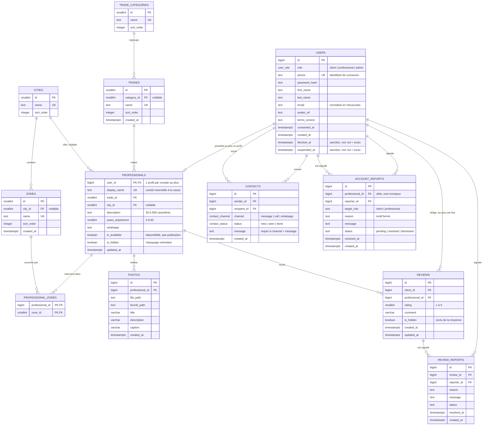

# Schéma relationnel - KOP

Diagramme de classes du modèle, style MERISE / _crow's foot_. Le complément
référentiel de [schema.md](schema.md) (colonnes, types, index) et de
[dictionnaire.md](dictionnaire.md) (règles métier).

Le diagramme est écrit en **Mermaid**, qui s'affiche nativement sur GitHub,
GitLab, VS Code et Notion. Une version texte est fournie plus bas, lisible dans
n'importe quel éditeur. L'entrée du dossier est [docs/README.md](../README.md),
Pour le contexte du produit et ce que les données permettent de mesurer, voir [CADRE.md](../CADRE.md).



## Version texte

Pour les lecteurs dont l'outil n'affiche pas Mermaid. Colonnes : entité source,
multiplicité, entité cible, clé étrangère.

```text
  Entité source          Multiplicité  Entité cible             Via
  ─────────────────────  ───────────  ───────────────────────  ─────────────────────
  TRADE_CATEGORIES       1        →n  TRADES                   trades.category_id
  TRADES                 1        →n  PROFESSIONALS            professionals.trade_id
  CITIES                 1        →n  ZONES                   zones.city_id
  CITIES                 0..1     ←n  PROFESSIONALS            professionals.city_id
  ZONES                  n        →1  PROFESSIONAL_ZONES       professional_zones.zone_id
  PROFESSIONALS          1        →n  PROFESSIONAL_ZONES       professional_zones.professional_id
  PROFESSIONALS          1        →n  PHOTOS                   photos.professional_id
  USERS                  1        →0..1 PROFESSIONALS         professionals.user_id
  USERS                  1        →n  REVIEWS                  reviews.client_id
  PROFESSIONALS          1        →n  REVIEWS                  reviews.professional_id
  USERS                  1        →n  REVIEWS                  reviews.professional_id
  USERS                  1        →n  CONTACTS                 contacts.sender_id
  USERS                  1        →n  CONTACTS                 contacts.recipient_id
  USERS                  1        →n  ACCOUNT_REPORTS         account_reports.reporter_id
  USERS                  1        →n  ACCOUNT_REPORTS         account_reports.professional_id
  USERS                  1        →n  REVIEW_REPORTS          review_reports.reporter_id
  REVIEWS                1        →n  REVIEW_REPORTS          review_reports.review_id
```

Lecture d'une ligne : `USERS 1 →n REVIEWS` signifie « un compte porte zéro ou
plusieurs avis ». La colonne « Via » nomme la colonne porteuse de la clé
étrangère, ce qui suffit à rebuild la jointure sans relire le schéma.

Trois relations méritent une note :

- `USERS → PROFESSIONALS` est un **0..1**, pas un 1..1 : la clé primaire de
  `professionals` est `user_id`, donc un compte porte au plus un profil.
- `CITIES → PROFESSIONALS` est un **0..1** : la colonne `city_id` est nullable.
- `USERS → REVIEWS` apparaît deux fois, par `client_id` et par
  `professional_id`. Ce ne sont pas deux tables : un avis appartient à un client
  _et_ à un artisan, et ces deux comptes sont nécessairement distincts.

## La vue `published_professionals`

Une vue n'est pas une table : elle ne stocke rien et n'a pas sa place dans un
diagramme de classes. Elle est donc absente du diagramme ci-dessus, et décrite
ici à part.

C'est pourtant l'objet le plus important du modèle, parce que **la règle de
publication y est écrite** en une seule fois et que tout le reste de
l'application passe par elle. Le disque ne contient aucun profil « public » : la
publication est une propriété calculée, recalculée à chaque lecture.

**Attention en la citant.** La vue est redéfinie par quatre migrations successives,
et seule la dernière compte. Une recherche de `CREATE VIEW published_professionals`
dans `server/db/migrations` renvoie quatre définitions très différentes : celles de
`1759500000000_init.sql` et de `1759500000003_update_rg04_publication.sql` ne
filtrent ni le rôle, ni les sanctions, et citent ces fichiers donnerait une vue
qui n'existe plus. La définition effective est celle de
`1759500000016_published_view_role.sql` :

```sql
CREATE OR REPLACE VIEW published_professionals AS
SELECT p.user_id,
       p.display_name,
       p.trade_id,
       p.description,
       p.years_experience,
       p.whatsapp,
       p.is_available,
       p.updated_at
  FROM professionals p
  JOIN users u ON u.id = p.user_id
  JOIN trades t ON t.id = p.trade_id
 WHERE NOT p.is_hidden
   AND u.role = 'professional'
   AND u.blocked_at IS NULL
   AND u.suspended_at IS NULL
   AND char_length(btrim(p.display_name)) > 0
   AND char_length(btrim(t.name)) > 0
   AND (EXISTS (SELECT 1 FROM professional_zones z WHERE z.professional_id = p.user_id))
   AND char_length(btrim(u.phone)) > 0
   AND char_length(btrim(p.description)) >= 30
   AND (EXISTS (SELECT 1 FROM photos ph WHERE ph.professional_id = p.user_id));
```

Les neuf conditions de publication, et l'endroit qui les applique, sont
détaillés dans [dictionnaire.md](dictionnaire.md).

Son grain est plus étroit que celui de `professionals` : une ligne de la vue
correspond à un artisan publiable, pas à un artisan. Les deux tables ne se comptent
donc pas de la même façon, et l'écart est mesurable sur les données actuelles.

## Grain

Une ligne de table, et le grain exact. Sans cette phrase, un `count(*)` n'a pas
de sens interprétable.

| Table                     | Grain - une ligne par…                             |
| :------------------------ | :------------------------------------------------- |
| `users`                   | compte                                             |
| `professionals`           | compte disposant d'un profil artisan               |
| `trades`                  | métier du référentiel                              |
| `trade_categories`        | catégorie de métiers                               |
| `cities`                  | ville                                              |
| `zones`                   | quartier                                           |
| `professional_zones`      | couple (artisan, quartier)                         |
| `photos`                  | photo de réalisation                               |
| `reviews`                 | avis - au plus un par (client, artisan)            |
| `contacts`                | prise de contact, dans un sens donné               |
| `account_reports`         | signalement - au plus un par (cible, auteur)       |
| `review_reports`          | signalement d'avis - au plus un par (avis, auteur) |
| `published_professionals` | artisan visible dans l'annuaire public             |

## Suppressions

Comportement **mesuré** sur la base, chaque essai étant annulé par `ROLLBACK`.
`||` = exactement un, `o{` = zéro ou plusieurs.

Point capital : toutes les clés étrangères sont **non deferrable**. Sur une telle
clé, `NO ACTION` se comporte comme `RESTRICT` - la suppression est refusée, elle
n'est pas différée. La colonne « Suppression » de `schema.md` affiche donc
`aucune`, mais la réalité est un blocage.

| Relation                             | Déclaré  | Comportement réel, vérifié                                                |
| :----------------------------------- | :------- | :------------------------------------------------------------------------ |
| `users → professionals`              | CASCADE  | le profil, ses zones et ses photos partent                                |
| `users → contacts`                   | CASCADE  | les prises de contact partent                                             |
| `users → account_reports`            | CASCADE  | les signalements dont il est l'auteur partent                             |
| `reviews → professionals`            | aucune   | **REFUSÉ** - `23503`, un artisan ayant des avis ne peut pas être supprimé |
| `professionals → photos`             | CASCADE  | part avec le profil                                                       |
| `professionals → professional_zones` | CASCADE  | part avec le profil                                                       |
| `zones → professional_zones`         | aucune   | **REFUSÉ** - `23503`, un quartier référencé ne peut pas être supprimé     |
| `trades → professionals`             | aucune   | **REFUSÉ** - `23503`, un métier référencé ne peut pas être supprimé       |
| `cities → zones`                     | SET NULL | la zone survit, devient orpheline                                         |
| `cities → professionals`             | SET NULL | le profil survit sans ville                                               |

Ce que cela change pour une analyse :

- **Aucun avis ne peut devenir orphelin.** Le blocage de clé étrangère empêche la
  suppression d'un artisan ayant des avis avant qu'elle ne rompe la référence. La
  jointure `reviews → professionals → users` ne perd donc aucune ligne par
  suppression de compte. C'est une garantie, pas une coïncidence.
- **Mais le CASCADE est neutralisé par ce même blocage.** Supprimer un compte
  client/artisan cascade vers `professionals`, qui bute sur `reviews` : la
  suppression échoue. Pour retirer un compte, il faut d'abord supprimer ses avis,
  ses photos et ses zones.
- **Le référentiel est protégé.** Les suppressions de quartier et de métier
  référencés ont été tentées pendant cette extraction et refusées (`23503`). Les
  référentiels ne se modifient donc pas par accident.

## Invariants et où ils sont appliqués

Une règle écrite **dans la base** vaut pour tous les écrivains : script,
migration, console d'administration, ou le code qu'on a oublié. Les règles
ci-dessous n'existent que dans l'application si la colonne « Où » dit
« service ».

| Invariant                                  | Où                                          |
| :----------------------------------------- | :------------------------------------------ |
| Note entre 1 et 5                          | base (`CHECK`)                              |
| Description entre 30 et 500 caractères     | base (`CHECK`)                              |
| Expérience entre 0 et 60 ans               | base (`CHECK`)                              |
| Motif de signalement dans une liste fermée | base (`CHECK`)                              |
| Un seul avis par (client, artisan)         | base (`UNIQUE`)                             |
| Un seul signalement par (cible, auteur)    | base (`UNIQUE`)                             |
| Pas d'auto-signalement                     | base (`CHECK`)                              |
| Pas de contact avec soi-même               | base (`CHECK`)                              |
| Nom affiché unique, insensible à la casse  | base (`index unique sur lower(btrim(...))`) |
| Un artisan ne s'avise pas lui-même         | service                                     |
| Un administrateur ne pose pas d'avis       | service                                     |
| Un profil n'est public que si complet      | vue `published_professionals`               |
| Blocage à 3 signalements, suspension à 5   | service, seuils configurables               |

## Limites pour l'analyse

Trois manques structurels, à connaître avant de construire un indicateur.

1. **`professionals` n'a pas de `created_at`.** Seule la date de dernière
   modification existe. Impossible de dater l'arrivée d'un artisan ni de mesurer
   un délai de mise en ligne. Contournement : `users.created_at` donne la date de
   création du compte, qui est la même ou antérieure.

2. **L'historique des notes n'existe pas.** Un avis se modifie et se supprime en
   place (`UPDATE` / `DELETE` existent dans le dépôt) ; seule sa valeur courante
   est conservée. Une série « note moyenne dans le temps » sera fausse, et
   silencieuseusement fausse. Il n'y a pas de table d'audit.

3. **`account_reports.professional_id` ne contient pas toujours un
   professionnel.** La colonne pointe vers `users.id` et sert de cible à un
   signalement de compte, client ou artisan ; c'est `target_role` qui distingue
   les deux. La jointure `professionals` sur cette colonne est donc un piège.
